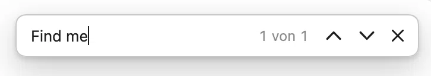

# 🔍 Arc-Style Find Bar

The find-in-page bar of [Zen Browser](https://zen-browser.app) (the search you open with `Cmd + F` / `Ctrl + F`), restyled like Arc's: small, floating in the top-right corner, with just the search field, match count, arrows and close.



> [!NOTE]
> Not available in the Zen mod store, because its repository ([zen-browser/theme-store](https://github.com/zen-browser/theme-store)) has been archived. On macOS, a small script installs it as a regular Zen mod anyway. It takes about two minutes.

## ⭐ Features

- Floats top-right instead of sitting at the bottom
- One clean row: `[ search   2 of 5 ] ⌃ ⌄ ✕`
- Arc-like highlights: all matches yellow, current match orange
- Subtle focus state on the bar and its buttons
- Works in light and dark mode

## 🛠️ Installation

**[⬇ Download zen-arc-findbar.zip](https://github.com/jan-voe/zen-arc-findbar/releases/latest/download/zen-arc-findbar.zip)** and unzip it (Safari does this automatically). You get a folder called `zen-arc-findbar`.

### macOS: with the install script

1. Quit Zen with `Cmd + Q`.
2. Open **Terminal** (`Cmd + Space`, type "Terminal", press Enter).
3. Paste this line and press Enter:
   ```bash
   zsh ~/Downloads/zen-arc-findbar/install.sh
   ```
   Folder not in Downloads? Type `zsh ` (with a space), drag `install.sh` into the Terminal window and press Enter.
4. Start Zen and press `Cmd + F` on any page.

The find bar now shows up in Zen's settings under **Zen Mods**, like any other mod. You can switch it off or remove it there.

<details>
<summary>What exactly the script changes</summary>

It only touches your Zen profile folder, downloads nothing and needs no admin rights. Step by step:

1. Exits with a message if Zen is still running, so you can quit it with `Cmd + Q` first.
2. Finds the profile Zen uses (from `profiles.ini`).
3. Adds an entry for this mod to `zen-themes.json`. Your other mods stay as they are.
4. Copies `chrome.css` and `README.md` to `chrome/zen-themes/<mod id>/`.
5. Rebuilds `chrome/zen-themes.css`, the file in which Zen combines all enabled mods.
6. Removes an older manual install of this find bar (`chrome/arc-findbar.css`), if there is one.
7. Adds the [highlight colors](#highlight-colors) from this folder's `user.js` to `user.js` in your profile.

Running it twice is safe. You can read `install.sh` and `install-mod.js` in any text editor before running them.

</details>

### Manual install (macOS, Windows, Linux)

Prefer not to run a script? These steps work on every system. The only difference: the find bar won't be listed under Zen Mods, and you remove it by hand.

1. In Zen, open `about:support`, find **Profile Folder** and click the button next to it (**Show in Finder** / **Open Folder**).
2. Create a folder named `chrome` there (if it doesn't exist).
3. Copy `chrome.css` into `chrome` and rename it to `arc-findbar.css`.
4. Is there already a `userChrome.css` in `chrome`?
   - **No:** copy `userChrome.css` from the download into `chrome`.
   - **Yes:** open it in a text editor and add this line at the very top (`@import` only works above all other rules):
     ```css
     @import url('arc-findbar.css');
     ```
5. Open `about:config`, accept the warning, and set `toolkit.legacyUserProfileCustomizations.stylesheets` to `true`.
6. Optional: set the [highlight colors](#highlight-colors).
7. Restart Zen.

### Updating

Zen doesn't update this mod by itself. Delete the old `zen-arc-findbar` folder, download the new ZIP and install again the same way (script: quit Zen and run it; manual: replace `arc-findbar.css`). This overwrites changes you made to the stylesheet.

## 💅🏼 Customization

### Highlight colors

Matches on the page are colored by browser settings, not by the stylesheet. The install script sets them. With the manual install, or to change them, use `about:config`:

| Preference                         | Value                          |
| ---------------------------------- | ------------------------------ |
| `findbar.highlightAll`             | `true` (highlight all matches) |
| `ui.textHighlightBackground`       | `#FFFF00` (all matches)        |
| `ui.textHighlightForeground`       | `#000000`                      |
| `ui.textSelectAttentionBackground` | `#FF9632` (current match)      |
| `ui.textSelectAttentionForeground` | `#000000`                      |

If you used the script, these live in `user.js` in your profile folder and are applied on every start, so change them there.

### Size, position and colors of the bar

Edit the variables at the top of `chrome.css` (`--arc-findbar-width`, `--arc-findbar-offset-top`, `--arc-findbar-bg`, …) in the downloaded folder and install again.

- `--arc-findbar-blur`: set to e.g. `12px` to blur the page behind the bar. Only visible if `--arc-findbar-bg` is semi-transparent.
- `--arc-findbar-focus-ring`: off by default. Set it to e.g. `0 0 0 2px rgba(0, 122, 255, 0.35)` to show a focus ring.

## 🗑️ Uninstall

**Installed with the script:** in Zen's settings under **Zen Mods**, click **Remove** next to Arc-Style Find Bar.

**Installed manually:** open your profile folder (`about:support` → **Profile Folder**), delete `chrome/arc-findbar.css` and the `@import` line in `chrome/userChrome.css` (or the whole file, if you copied it from the download and added nothing), then restart Zen. If you don't use any other custom styles, also reset `toolkit.legacyUserProfileCustomizations.stylesheets` in `about:config`.

**Highlight colors:** if you used the script, also remove this mod's lines from `user.js` in your profile folder. Then reset the preferences from the table above in `about:config`.

## Known limitations

- Tested on Zen 1.24.3b (aarch64), Firefox 160.0.1, macOS (Darwin 27.2.0), including split view. Not tested on Windows or Linux yet.
- Zen updates can change the find bar and break the layout.
- The install script uses Zen's internal mod format, which isn't officially documented. A future Zen version could change it.
- The match count hides the word after the numbers. For locales that put the word before the numbers (French, Italian, Portuguese, Catalan, Chinese, Japanese, Turkish, Swedish), the full label is kept on one line instead.
- Match case, whole words and diacritics are hidden. Their last setting still applies.

## Credits

Focus states and the optional backdrop blur were adapted from [Rou-dou-dou's fork](https://github.com/Rou-dou-dou/zen-arc-findbar-alt).

## License

[MIT](LICENSE)
